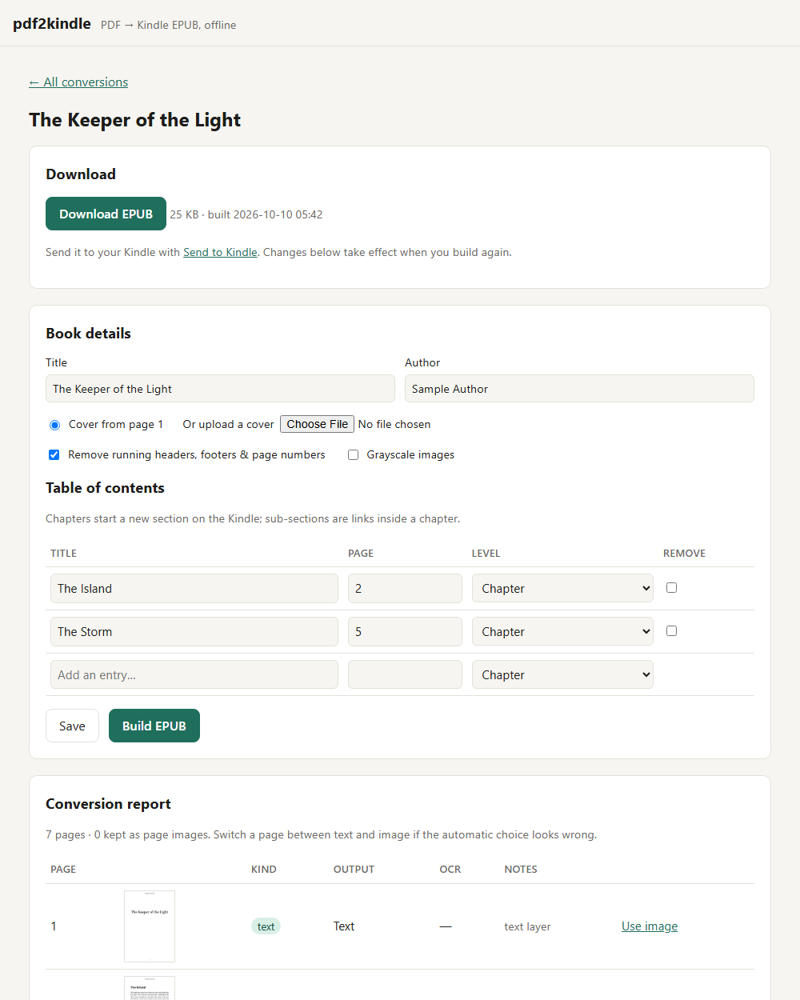

# pdf2kindle

[](https://github.com/Nipun4338/pdf2kindle/actions/workflows/ci.yml)
[](LICENSE)

Turn a PDF (Bengali, English or mixed) into a **reflowable EPUB** that reads well on a Kindle.
Everything runs on your own machine: no accounts, no API keys, and your books never leave it.

- **Digital PDFs**: text is extracted, paragraphs are rebuilt, end-of-line hyphens are joined,
  and running headers, footers and page numbers are removed.
- **Bijoy / SutonnyMJ PDFs**: old pre-Unicode Bengali text is remapped to Unicode.
- **Scanned PDFs, and Bengali PDFs whose text layer is broken**: OCR'd with Tesseract
  (`ben+eng`).
- **Pages that can't be reflowed reliably** (tables, multi-column layouts, maths, low-confidence
  OCR) are kept as page images (an *Image Fallback*), so you never get garbled text.
- **Navigation**: the table of contents comes from the PDF's bookmarks, or from heading sizes if
  there are none. You can edit it before building.
- **Kindle compatibility**: EPUB 3 plus an NCX, Noto Serif Bengali embedded whenever there is
  Bengali text, footnotes collected at the end of each chapter, and images compressed so the book
  stays under Send-to-Kindle's 50 MB email limit.



Vocabulary is defined in [CONTEXT.md](CONTEXT.md); key decisions are in [docs/adr](docs/adr).

## Run it

### One click

- **Windows**: double-click **`run.bat`**.
- **macOS / Linux**: run `./run.sh`.

The first run installs everything into a local `.venv` (it needs Python 3.12+). On Windows it
offers to install Tesseract with winget, and on every platform it downloads the Bengali and
English OCR models. Later runs just start the app and open <http://127.0.0.1:8000> in your browser.
Close the window or press Ctrl+C to stop it.

### Docker (Tesseract and the Bengali models included)

```bash
docker build -t pdf2kindle .
```
```bash
docker run --rm -p 8000:8000 -v pdf2kindle-data:/data pdf2kindle
```

Tagged releases also publish `ghcr.io/nipun4338/pdf2kindle`.

Then open <http://localhost:8000>.

### Manual setup (Windows, macOS, Linux)

1. Install [uv](https://docs.astral.sh/uv/) and Python 3.12+.
2. Install Tesseract with Bengali support:
   - **Windows**: `winget install UB-Mannheim.TesseractOCR`. During setup, tick *Bengali* under
     additional languages. Alternatively, put `ben.traineddata` from
     [tessdata_best](https://github.com/tesseract-ocr/tessdata_best) in the `tessdata` folder.
   - **macOS**: `brew install tesseract tesseract-lang`
   - **Debian/Ubuntu**: `sudo apt install tesseract-ocr tesseract-ocr-ben`

   For the best Bengali accuracy, put the `tessdata_best` models (`ben`, `eng`, `osd`) in
   `~/.pdf2kindle/tessdata`. The app uses that folder automatically unless `TESSDATA_PREFIX` is
   set.
3. Start it:

```bash
uv run pdf2kindle serve
```

Without Tesseract the app still works, but pages that need OCR become page images.

### Command line

```bash
uv run pdf2kindle convert book.pdf book.epub --lang auto
```

## Using it

1. Upload a PDF. Optionally choose its language and whether to strip headers and footers.
2. Wait for analysis. Progress is shown per page, and you can leave the page while it runs.
3. Review:
   - **Book details**: title, author and cover (page 1 or an uploaded image).
   - **Table of contents**: rename, remove, add, or switch entries between *chapter* and
     *sub-section*.
   - **Conversion report**: each page's kind (text, legacy, scanned or complex), whether it became
     a page image, and its OCR confidence. Click **Use text** or **Use image** to override a page.
4. Click **Build EPUB**, download it, and send it with
   [Send to Kindle](https://www.amazon.com/sendtokindle).

Conversions are stored in `~/.pdf2kindle` (or `$PDF2KINDLE_DATA_DIR`) and deleted after 30 days
(`$PDF2KINDLE_RETENTION_DAYS`).

| Setting | Default | Meaning |
|---|---|---|
| `PDF2KINDLE_DATA_DIR` | `~/.pdf2kindle` | where uploads, cached pages and EPUBs live |
| `PDF2KINDLE_RETENTION_DAYS` | `30` | conversions older than this are removed |
| `TESSERACT_CMD` | on `PATH` | path to the `tesseract` executable |
| `TESSDATA_PREFIX` | `~/.pdf2kindle/tessdata` if present | folder with `ben`/`eng` `.traineddata` |

## Development

```bash
uv sync
uv run playwright install chromium   # fixture PDFs and end-to-end tests
sh scripts/get-epubcheck.sh          # EPUB validator (needs Java)
uv run ruff check src tests && uv run ruff format --check src tests
uv run pytest
```

Test PDFs are generated in code ([tests/fixtures.py](tests/fixtures.py)), so no copyrighted books
are committed. Tests that need Tesseract or epubcheck skip when those aren't installed; CI installs
both.

### How it works

```
PDF ─► pdf.py        pdfminer.six lines + fonts, pypdfium2 rendering and bookmarks
    ─► classify.py   Text / Legacy-Encoded / Scanned / Complex per page
    ─► legacy/       Bijoy → Unicode          ocr.py  Tesseract (+ deskew, binarise)
    ─► layout.py     page noise, footnotes, headings, paragraphs, de-hyphenation
    ─► assemble.py   chapters from the TOC, figures, Image Fallback pages
    ─► epub.py       EPUB 3 + NCX, embedded Bengali font
```

## Licence

MIT. Noto Serif Bengali is under the SIL Open Font License. The dependencies were chosen to be
MIT/Apache/BSD-compatible; see [ADR 0001](docs/adr/0001-permissive-pdf-stack-instead-of-pymupdf.md).
